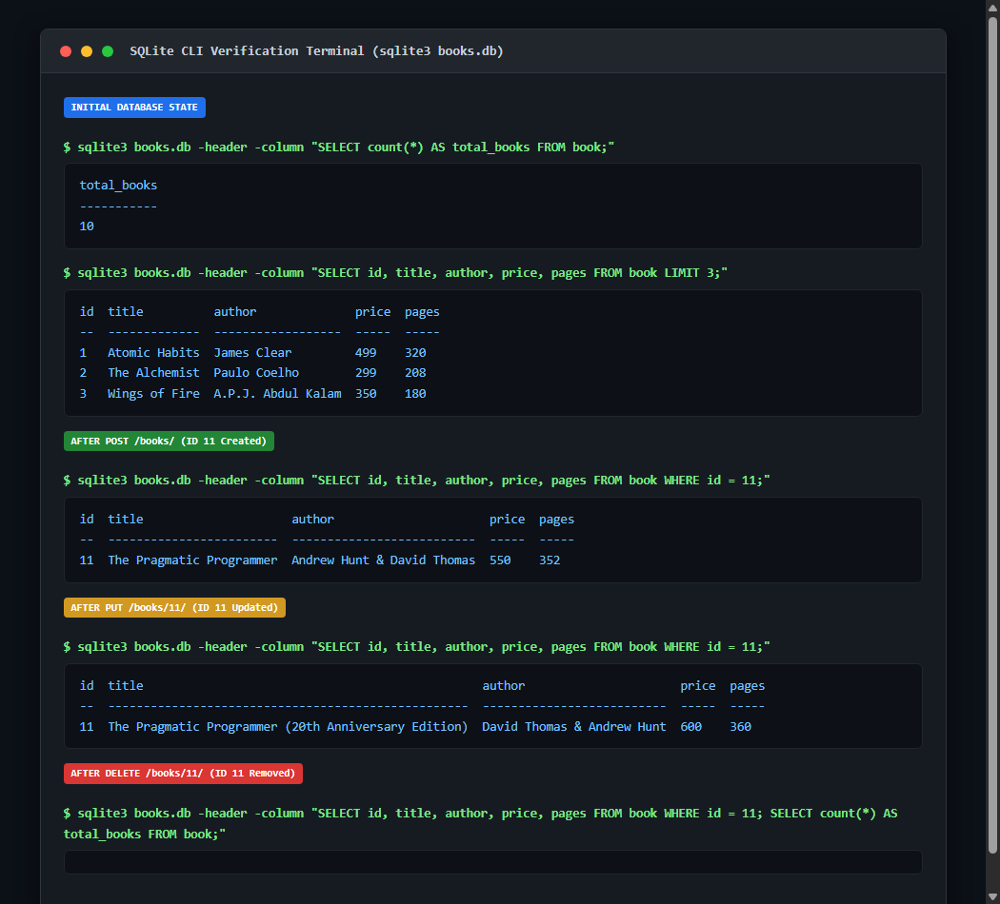

# Lab 02: SQLite Database and CRUD Routes

## Student Information
- **Student Name:** Myadaboina Prasanna Kumar
- **Registration Number:** [YOUR_REGISTRATION_NUMBER]
- **Section:** [YOUR_SECTION]

---

## Deployment Information & Render Guide

- **Platform:** [Render](https://render.com/) (Web Service)
- **Live Deployment URL:** `[YOUR_RENDER_URL]` *(Update with your live URL once deployed, e.g. `https://backend-development-fundamentals-lab-02.onrender.com`)*
- **Current Deployment Status:** `PREPARED (PENDING DASHBOARD SETUP)`

### Render Dashboard Recommended Settings

| Setting | Recommended Value | Description |
| :--- | :--- | :--- |
| **Service Type** | **Web Service** | Hosted container running Express.js |
| **Name** | `backend-development-fundamentals-lab-02` | Unique application identifier |
| **Root Directory** | *(Leave blank / default)* | `package.json` and `server.js` are at the repository root |
| **Runtime** | `Node` | Native Node.js execution runtime |
| **Build Command** | `npm install` | Installs express, sqlite, sqlite3, and nodemon |
| **Start Command** | `npm start` | Executes `node server.js` |
| **Instance Type** | `Free` | Zero-cost development tier |

### Environment Variables on Render
Add this key-value pair under the **Environment Variables** tab in your Render dashboard:

| Key | Value | Description |
| :--- | :--- | :--- |
| `NODE_ENV` | `production` | Optimizes Express for production performance |

---

### Step-by-Step Render Deployment Instructions

Follow these simple steps to deploy Lab 02 to Render:

1. **Sign in to Render:** Go to [dashboard.render.com](https://dashboard.render.com/) and log in using your GitHub account (`prasannakumar0718`).
2. **Create New Web Service:** Click **New +** → **Web Service**.
3. **Connect Repository:** Select your dedicated Lab 02 repository: **`prasannakumar0718/Backend_development_fundamentals_lab_02`**.
4. **Settings:**
   - Render automatically detects Node.js!
   - Root Directory: *(Leave blank)*
   - Build Command: `npm install`
   - Start Command: `npm start`
   - Plan: `Free`
5. **Set Environment Variable:**
   - In **Environment Variables**, add:
     - Key: `NODE_ENV`, Value: `production`.
6. **Deploy:** Click **Create Web Service**. Wait 1–2 minutes for the build to finish.
7. **Verify Public URL:** Once the service shows **`Live`**, copy the assigned URL (e.g., `https://backend-development-fundamentals-lab-02.onrender.com`).
8. **Test Live Endpoints:**
   - Root Health: `GET https://[YOUR_RENDER_URL]/` → returns `"Book Store API is running."`
   - All Books: `GET https://[YOUR_RENDER_URL]/books/` → returns array of 10 books.
   - Single Book: `GET https://[YOUR_RENDER_URL]/books/1/` → returns book 1.

---

## Project Overview

This project provides the complete laboratory implementation for **Lab 02 — SQLite Database and CRUD Routes** in the *Backend Development Fundamentals* course.

Key features:
1. **Asynchronous Initialization:** Uses an async `initializeDBAndServer()` function to open the database and verify the table schema before starting the Express HTTP listener.
2. **Render Cloud & Local Host Binding:** Express binds to `process.env.PORT || 3000` on `0.0.0.0`, ensuring compatibility with both Render containers and local workstations.
3. **SQL Injection Protection:** Every query accepting input from clients strictly utilizes parameterized SQL queries with `?` placeholders.
4. **Complete RESTful CRUD API:** Provides full Create, Read, Update, and Delete capabilities with standard HTTP status codes (`200 OK`, `201 Created`, `400 Bad Request`, `404 Not Found`, and `500 Internal Server Error`).

---

## Technologies Used

- **Runtime:** [Node.js](https://nodejs.org/) (v24.x)
- **Web Framework:** [Express.js](https://expressjs.com/) (v5.x)
- **Database Engine:** [SQLite3](https://www.sqlite.org/) (v3.51.x)
- **Database Client Packages:** `sqlite` (Promise wrapper) & `sqlite3`
- **Development Tooling:** `nodemon` (Hot reload development server)
- **API Testing:** Postman & VS Code REST Client

---

## Database Schema (`books.db`)

The SQLite database file `books.db` contains a table named `book` with the following schema:

```sql
CREATE TABLE IF NOT EXISTS book (
  id INTEGER PRIMARY KEY AUTOINCREMENT,
  title TEXT NOT NULL,
  author TEXT NOT NULL,
  price INTEGER NOT NULL,
  pages INTEGER NOT NULL
);
```

### Table Column Details

| Column | Data Type | Constraints | Description |
| :--- | :--- | :--- | :--- |
| `id` | `INTEGER` | `PRIMARY KEY AUTOINCREMENT` | Auto-incrementing unique identifier |
| `title` | `TEXT` | `NOT NULL` | Title of the publication |
| `author` | `TEXT` | `NOT NULL` | Author's full name |
| `price` | `INTEGER` | `NOT NULL` | Price in INR |
| `pages` | `INTEGER` | `NOT NULL` | Total number of pages |

### Initial 10 Seed Records

| ID | Title | Author | Price | Pages |
| :---: | :--- | :--- | :---: | :---: |
| 1 | Atomic Habits | James Clear | 499 | 320 |
| 2 | The Alchemist | Paulo Coelho | 299 | 208 |
| 3 | Wings of Fire | A.P.J. Abdul Kalam | 350 | 180 |
| 4 | Deep Work | Cal Newport | 450 | 304 |
| 5 | Rich Dad Poor Dad | Robert Kiyosaki | 399 | 336 |
| 6 | Ikigai | Hector Garcia | 320 | 208 |
| 7 | Think and Grow Rich | Napoleon Hill | 250 | 238 |
| 8 | The Power of Habit | Charles Duhigg | 420 | 371 |
| 9 | Zero to One | Peter Thiel | 400 | 224 |
| 10 | Clean Code | Robert C. Martin | 850 | 464 |

---

## Installation & Running Locally

### 1. Prerequisites
Verify system runtime:
```bash
node --version
npm --version
sqlite3 --version
```

### 2. Navigate to Project Directory & Install Dependencies
```bash
cd lab-02
npm install
```

### 3. Run Development Server (with automatic nodemon restart)
```bash
npm run dev
```

### 4. Run Production Server
```bash
npm start
```
*Console output confirms: `Server is running at http://0.0.0.0:3000/`*

### 5. Automated API Test Suite
With the server running in another terminal:
```bash
npm run test:api
```

---

## API Endpoints Documentation

| HTTP Method | URL Path | Description | Expected Status |
| :--- | :--- | :--- | :---: |
| `GET` | `/` | API health check message | `200 OK` |
| `GET` | `/books/` | Retrieve all books from the database | `200 OK` |
| `GET` | `/books/:bookId/` | Retrieve a single book by its ID | `200 OK` |
| `POST` | `/books/` | Add a new book record | `201 Created` |
| `PUT` | `/books/:bookId/` | Update details of an existing book by ID | `200 OK` |
| `DELETE` | `/books/:bookId/` | Delete an existing book by ID | `200 OK` |

---

## Example Request Bodies & Responses

### 1. `GET /books/`
- **Response (200 OK):**
  ```json
  [
    {
      "id": 1,
      "title": "Atomic Habits",
      "author": "James Clear",
      "price": 499,
      "pages": 320
    },
    ... (10 initial records)
  ]
  ```

### 2. `GET /books/1/`
- **Response (200 OK):**
  ```json
  {
    "id": 1,
    "title": "Atomic Habits",
    "author": "James Clear",
    "price": 499,
    "pages": 320
  }
  ```

### 3. `POST /books/`
- **Request Body:**
  ```json
  {
    "title": "The Pragmatic Programmer",
    "author": "Andrew Hunt & David Thomas",
    "price": 550,
    "pages": 352
  }
  ```
- **Response (201 Created):**
  ```json
  {
    "message": "Book Successfully Added",
    "bookId": 11
  }
  ```

### 4. `PUT /books/11/`
- **Request Body:**
  ```json
  {
    "title": "The Pragmatic Programmer (20th Anniversary Edition)",
    "author": "David Thomas & Andrew Hunt",
    "price": 600,
    "pages": 360
  }
  ```
- **Response (200 OK):**
  ```json
  {
    "message": "Book Details Updated Successfully"
  }
  ```

### 5. `DELETE /books/11/`
- **Response (200 OK):**
  ```json
  {
    "message": "Book Deleted Successfully"
  }
  ```

### 6. Error Cases
- **Nonexistent Book (`GET /books/999/` or `DELETE /books/999/`):**
  - Status: `404 Not Found`
  - Body: `{"error": "Book Not Found"}`
- **Invalid ID Format (`GET /books/abc/`):**
  - Status: `400 Bad Request`
  - Body: `{"error": "Invalid book ID. ID must be a numeric value."}`
- **Missing Required Fields (`POST /books/`):**
  - Status: `400 Bad Request`
  - Body: `{"error": "Missing required fields: title, author, price, and pages are required."}`

---

## SQL Injection Protection & Parameterized Queries

### What is SQL Injection?
SQL Injection occurs when user-supplied input is directly concatenated or formatted into raw SQL queries:
```javascript
// DANGEROUS CODE - DO NOT USE:
const query = `SELECT * FROM book WHERE id = ${bookId};`;
```
If an attacker inputs `1 OR 1=1`, the query alters database logic to return all records or execute malicious administrative commands (`1; DROP TABLE book; --`).

### Parameterized Queries (`?` Placeholders)
Parameterized queries separate SQL code from user-supplied data:
```javascript
// SECURE CODE - IMPLEMENTED IN THIS PROJECT:
const query = `SELECT * FROM book WHERE id = ?;`;
const book = await db.get(query, [bookId]);
```
The database engine treats `?` strictly as a literal data parameter, neutralizing SQL injection attempts.

In `server.js`:
- **SELECT:** `SELECT * FROM book WHERE id = ?;`
- **INSERT:** `INSERT INTO book (title, author, price, pages) VALUES (?, ?, ?, ?);`
- **UPDATE:** `UPDATE book SET title = ?, author = ?, price = ?, pages = ? WHERE id = ?;`
- **DELETE:** `DELETE FROM book WHERE id = ?;`

---

## Postman Testing Guide & Required Screenshots

The Postman collection is located at [`postman_collection.json`](./postman_collection.json).

### How to Execute Postman Testing Manually:
1. Open the **Postman** desktop application.
2. Click **Import** (top left) and select `D:\lab 1 bk\lab-02\postman_collection.json`.
3. In a terminal, run `npm run dev` to start the server at `http://localhost:3000`.
4. Execute each request in order:
   - `1. GET All Books`
   - `2. GET Single Book by ID (Existing ID 1)`
   - `3. POST Create Book (Returns ID 11)`
   - `4. PUT Update Book (ID 11)`
   - `5. DELETE Book by ID (ID 11)`
   - `6. GET Nonexistent Book (404 Not Found)`
   - `7. GET Invalid Book ID (400 Bad Request)`
5. Capture a screenshot of each Postman response window using `Win + Shift + S` and save them into the `screenshots/` directory using the filenames below.

### Postman Screenshots

#### 1. GET All Books


#### 2. GET Single Book


#### 3. POST Create Book


#### 4. PUT Update Book


#### 5. DELETE Book


#### 6. Error: Not Found (404)


#### 7. Error: Invalid ID (400)


---

## SQLite Database Verification

Database modifications were verified using the SQLite CLI (`sqlite3 books.db`).

### SQLite Verification Screenshot


### Terminal Commands Used for CLI Verification:
```bash
# Open database
sqlite3 books.db

# Enable column formatting and headers
.headers on
.mode column

# 1. Verify initial count (10)
SELECT count(*) AS total_books FROM book;

# 2. Verify inserted record (after POST)
SELECT * FROM book WHERE id = 11;

# 3. Verify updated record (after PUT)
SELECT * FROM book WHERE id = 11;

# 4. Verify deletion (after DELETE)
SELECT * FROM book WHERE id = 11;
SELECT count(*) AS total_books FROM book;

# Exit
.exit
```

---

## Problems Faced and Solutions

1. **Workflow Consistency:**
   - *Problem:* Modifying record ID 1 alters the initial seed dataset permanently.
   - *Solution:* Standardized on a unified test workflow: POST inserts book ID 11, PUT updates book ID 11, and DELETE removes book ID 11. The initial 10 records remain untouched.

2. **Render Cloud & Local Host Binding:**
   - *Problem:* Hardcoding `localhost` prevents Render's reverse proxy from forwarding requests into the container.
   - *Solution:* Configured Express to listen on `0.0.0.0` with `process.env.PORT || 3000`.

3. **Asynchronous Server Startup:**
   - *Problem:* Calling `app.listen()` before the database connection is open causes runtime errors on early requests.
   - *Solution:* Enclosed startup in `async initializeDBAndServer()`, awaiting `open()` and `db.exec()` before calling `app.listen()`.

4. **Tracking Database File in Version Control:**
   - *Problem:* Standard Node `.gitignore` files exclude `.db` files, but the assignment requires submitting `books.db`.
   - *Solution:* Specifically configured `lab-02/.gitignore` to track `books.db` while excluding `node_modules` and `.env`.
